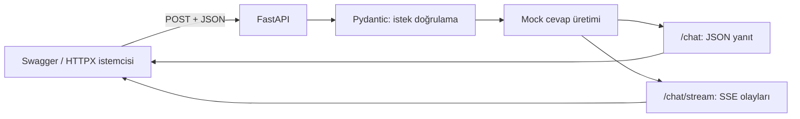
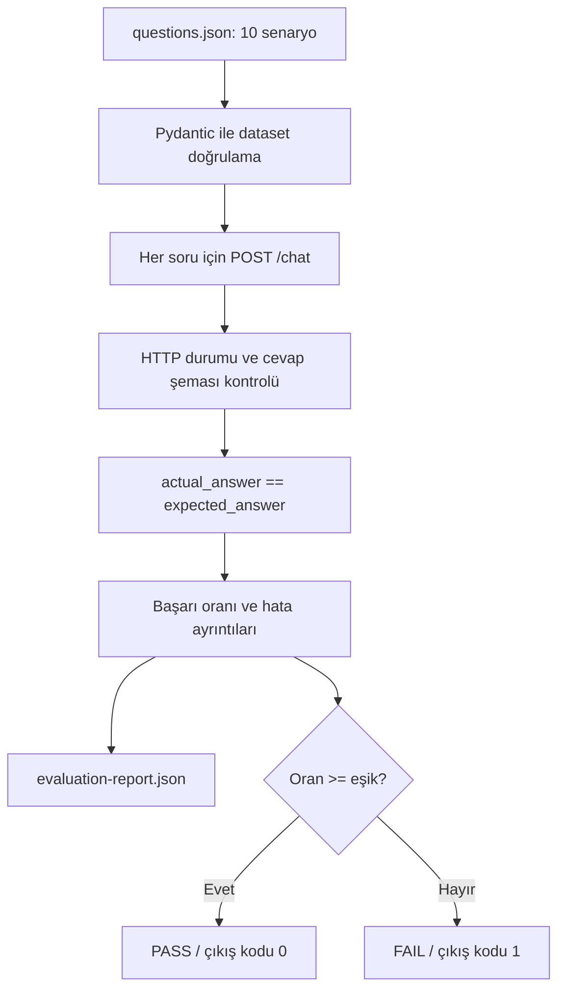

# LLM API Lab — Öğrenme ve Görüşme Notları

## 1. Ne yaptık?

Gerçek LLM yerine sabit cevaplar üreten bir **mock API** geliştirdik.
Amaç, ücret ve API anahtarı olmadan API testlerinden temel AI evaluation
akışına geçişi öğrenmek.

Swagger üzerinden başarılı istek ve boş prompt doğrulamasını denedik.
Streaming istemcisini inceledik; ardından 10 soruluk dataset ile cevapları
ölçen, JSON raporu ve kalite kapısı sonucu üreten bir komut ekledik.

## 2. Sistem nasıl çalışıyor?



Normal istek örneği:

```text
POST /chat
Gövde: {"prompt": "Fransa'nın başkenti neresi?"}
Yanıt: {"answer": "Paris", "confidence": 0.99}
```

`MOCK_ANSWERS` sözlüğünde bulunmayan sorular `Mock yanıt: ...` biçiminde
geri döner. `confidence=0.99` sabit bir demo değeridir; ölçülmüş güven değildir.

## 3. Kavramların projedeki karşılığı

| Kavram | Projede ne yaptık? |
|---|---|
| REST / HTTP | `POST /chat` ile JSON istek gönderip HTTP yanıtı aldık. |
| JSON | İstekleri, cevapları, dataset'i ve raporu yapılandırılmış veri olarak taşıdık. |
| Type hints | Fonksiyonların giriş ve dönüş türlerini belirttik; tek başına çalışma anında doğrulama yapmaz. |
| Pydantic | Prompt uzunluğunu, cevap alanlarını ve `confidence` aralığını doğruladık. |
| Structured output | `answer` ve `confidence` alanları olan yanıt şeması kullandık. Bu, gerçek LLM'in şemaya zorlanması değil, API yanıt sözleşmesidir. |
| Streaming / SSE | Cevabı `data:` olaylarında parçalar halinde taşıdık; `[DONE]` ile bitirdik. |
| pytest | API, veri doğrulama, evaluation ve eşik davranışlarını otomatik test ettik. |
| Evaluation | Gerçek cevabı dataset'teki beklenen cevapla birebir karşılaştırdık. |
| Quality gate | Doğruluk eşiğine göre komutun başarılı veya başarısız çıkmasını sağladık. |

Prompt boş veya 500 karakterden uzunsa API `422` döner. Şema
doğrulamasından geçmek, cevabın bilgi olarak doğru olduğunu garanti etmez.

## 4. Streaming ile normal yanıtın farkı

```text
Normal:    İstek → tek JSON yanıt
Streaming: İstek → parça 1 → parça 2 → [DONE]
```

```text
data: {"chunk": "Mock yanıt: "}

data: {"chunk": "Merhaba"}

data: [DONE]
```

Boş satır bir SSE olayını bitirir. İstemci JSON içindeki `chunk` alanını
okuyup parçaları sırayla gösterir. Her olay ayrı JSON içerir; tüm SSE gövdesi
tek bir JSON belgesi değildir. Demoda yapay gecikme yoktur, dolayısıyla
parçalar çok hızlı görünebilir.

**Streaming, AsyncIO demek değildir.** Mevcut kod senkron HTTPX ve
generator kullanır. `yield` parçaları sırayla üretir; henüz
`async/await` veya eşzamanlı istek uygulaması eklemedik.

## 5. Evaluation akışı



Örnek dataset kaydı:

```json
{
  "id": "capital-fr",
  "prompt": "Fransa'nın başkenti neresi?",
  "expected_answer": "Paris"
}
```

Başlangıç sürümünde 8 doğru, 2 yanlış sonuç vardır:
`accuracy = 8 / 10 = 0.8`, yani **%80**. Almanya'nın başkenti ve çıkarma
soruları için mock cevaplar özellikle eklenmemiştir.

| Durum | Sonuç |
|---|---|
| Doğruluk %80, varsayılan eşik %100 | FAIL, çıkış kodu `1` |
| Doğruluk %80, eşik %80 | PASS, çıkış kodu `0` |
| API bağlantı, HTTP veya cevap şeması hatası | Komut hatayla durur; normal cevap uyuşmazlığı sayılmaz. |

Hata halinde yeni rapor yazılmaz; önceki çalıştırmadan kalan bir raporu
güncel sonuç sanmamak gerekir.

**Sınır:** Karşılaştırma birebir metin eşleşmesidir. `Paris` ile `paris`
bile farklı sayılır. Bu oran yalnızca bu küçük demo dataset'ini temsil
eder; genel model kalitesi, hallucination oranı veya semantik doğruluk değildir.

## 6. API testi ile evaluation farkı

**API testi:** “Endpoint çalışıyor mu, doğru HTTP kodunu ve şemayı dönüyor mu?”

**Evaluation:** “Şeması geçerli cevabın içeriği beklenen cevapla eşleşiyor mu?”

Testler `TestClient` üzerinden uygulamayı sunucu başlatmadan çağırır.
Evaluation komutu ise çalışan API'ye gerçek HTTP istekleri gönderir.
Toplam 15 test örneği; mevcut API davranışını, geçersiz dataset'leri,
başlangıçtaki %80 sonucu, HTTP/şema hatalarını ve eşik çıkış kodlarını kapsar.

## 7. Dosya haritası

```text
app.py                  API, Pydantic modelleri, mock cevaplar ve SSE
client.py               Normal istek ve streaming istemcisi
evaluate.py             Dataset okuma, karşılaştırma, rapor ve kalite kapısı
datasets/questions.json 10 soruluk beklenen cevap seti
tests/                  Otomatik API ve evaluation testleri
pyproject.toml          Bağımlılıklar ve proje kurulumu
```

## 8. Görüşmede kısa anlatım

> Python ve FastAPI ile, gerçek LLM yerine mock kullanan küçük bir API
> ve evaluation demosu üzerinde çalıştım. JSON istek ve yanıtlarını
> Pydantic ile doğruladım; normal yanıt ile SSE streaming arasındaki farkı
> uygulamalı gördüm. On soruluk bir dataset üzerinde beklenen ve gerçek
> cevapları birebir karşılaştıran bir akış kurduk. Akış JSON raporu
> üretiyor ve doğruluk eşiğine göre çıkış koduyla kalite kapısı uyguluyor.
> Böylece API'nin teknik olarak çalışması ile cevabın doğru olması
> arasındaki farkı somutlaştırdım.

Bu çalışma **temel, uygulamalı bir demo deneyimidir**, üretim ortamı veya
gerçek LLM değerlendirme tecrübesi olarak sunulmamalı.
Henüz gerçek LLM bağlantısı, LLM-as-a-Judge, RAG, agent/MCP testleri,
AsyncIO, güvenlik taraması ve CI/CD pipeline eklemedik.
Mevcut kalite kapısı CI/CD'ye bağlanabilir, ancak şu anda yerel komuttur.

## 9. Kısa demo ve öğrenme deneyi

Mac'teki mevcut proje klasöründe, servis için:

```bash
source .venv-1/bin/activate
python -m uvicorn app:app --reload
```

Başka bir terminalde, aynı klasörde:

```bash
source .venv-1/bin/activate
python -m evaluate --report before.json
python -m evaluate --min-accuracy 0.8
python -m pytest -v
```

İlk evaluation'ın `FAIL` olması beklenir. `app.py` içindeki
`MOCK_ANSWERS` sözlüğüne Almanya cevabını ekleyip tekrar ölçersen %90;
çıkarma cevabını da eklersen %100 beklenir. Bunlar başlangıç sürümüne göre
alıştırma sonuçlarıdır; yerelinde yapıldığını burada varsaymıyoruz.

**Öğrenme döngüsü:** hatayı raporda bul → sistem davranışını düzelt →
aynı dataset ile yeniden ölç. Skoru artırmak için beklenen cevapları
gerçek çıktıya uydurma. Mock davranışını değiştirdiğinde başlangıçtaki
%80'i sabitleyen testin beklentilerini de bilinçli güncelle.
